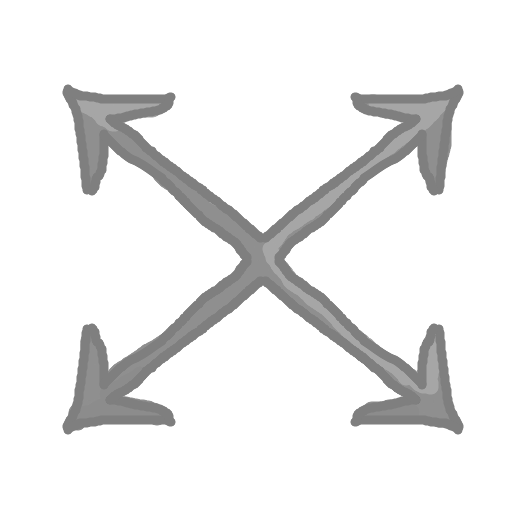
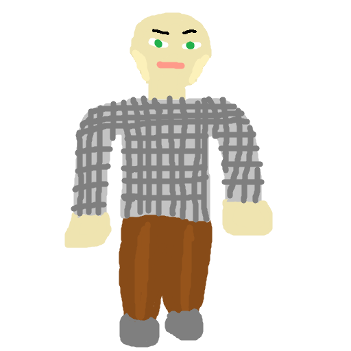
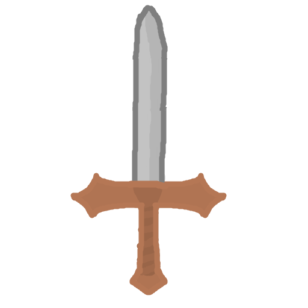
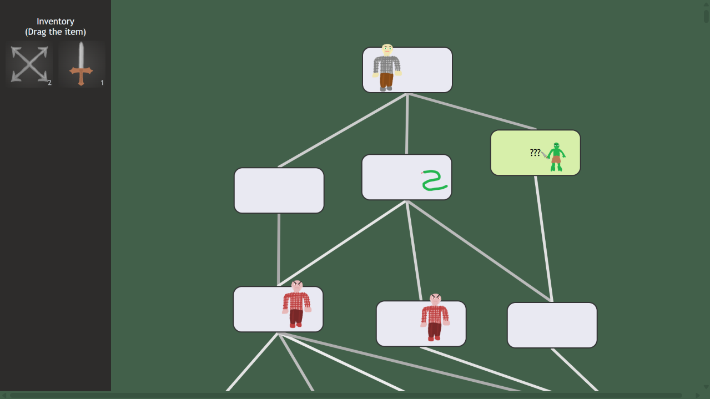
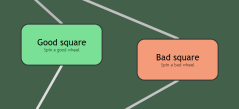
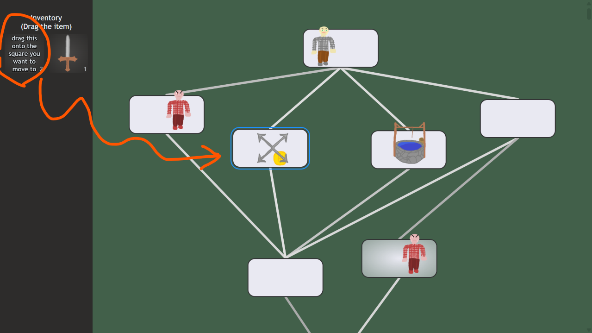

A website board game, where you have to get from the top the bottom without dying.  
How to play it: 
Open the website https://d9m9nt9d.github.io/board-game. To start playing drag the  (move) item  in your inventory to the closest square that is connected to the square your standing on (you are the (bald guy) that is standing on the top square alone). After that if there are enemies nearby they will move 2 times. You will have to attack them with your sword, every time you use your sword enemies move 1 time. If there aren't any enemies just keep progressing to the bottom of the map. To win you have to move down 80 rows of squares. You will find items and good squares that will help you progress, but there also are bad squares.  
How the game looks: 
 
Good and bad squares: 
 
How the game should behave when you drag an item: 
  
How i built it: 
I used HTML, CSS, and JavaScript. I divided the game into 3 main things: items, squares, entities. Each is it's own script and they are all connected with the main script. Used hcg-draggable library for dragging items.  
Why i made it: 
To see if i can make a game directly in web and to practice making games that can be replayed for a different outcome each time.
